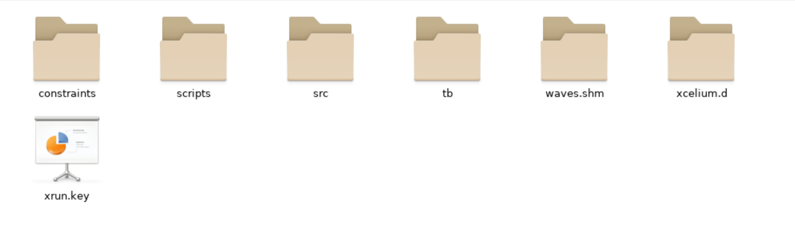
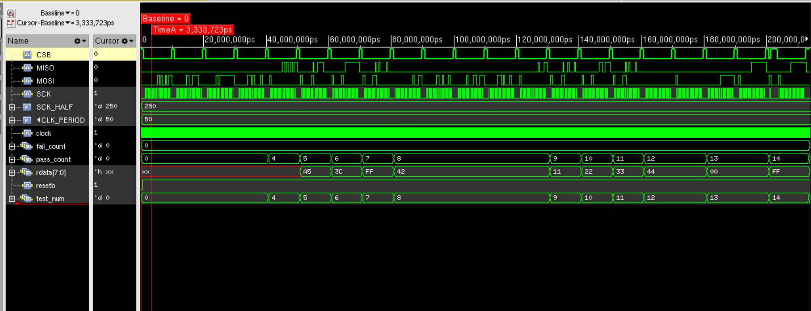
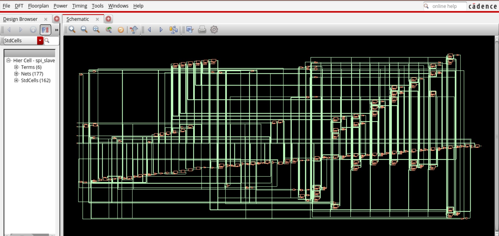
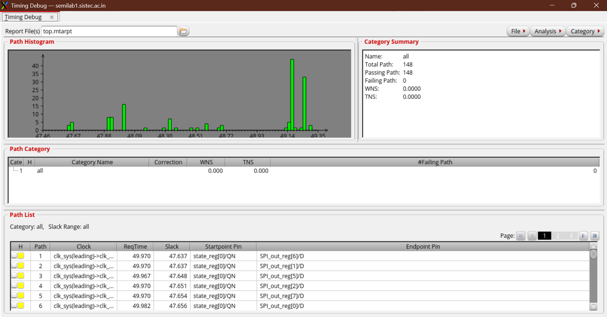
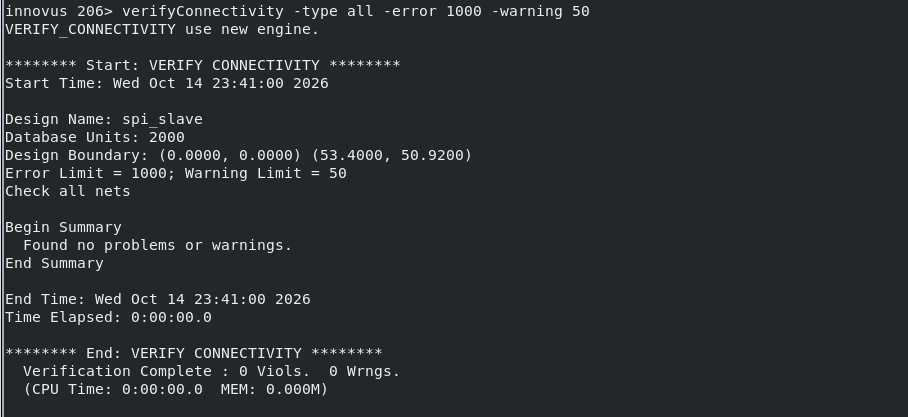

# 🚀 4-Wire Synchronous SPI Slave: Complete RTL-to-GDSII ASIC Flow (45nm GPDK)

[](LICENSE)
[](#)
[-blue.svg)](#)
[](#)
[](#)
[-brightgreen.svg)](#)

A complete, production-grade digital ASIC implementation of a **4-wire synchronous SPI Slave core** with Clock Domain Crossing (CDC) synchronizers, command decoder FSM, and internal register bank, carried out from synthesizable Verilog RTL to clean **GDSII** stream-out using the **Cadence Digital Implementation Flow** on **45nm GPDK (Generic Process Design Kit)** standard cells.

---

## 📑 Table of Contents
- [Architecture & Design Specifications](#-architecture--design-specifications)
- [Repository Structure](#-repository-structure)
- [Key Implementation Deliverables (Output)](#-key-implementation-deliverables-output)
- [ASIC Implementation Overview](#-asic-implementation-overview)
- [1. Cadence Xcelium (`xrun`) Simulation & Waveforms](#1-cadence-xcelium-xrun-simulation--waveforms)
- [2. Cadence Genus Synthesis Reports](#2-cadence-genus-synthesis-reports)
- [3. Cadence Innovus Place & Route (PnR) Layouts](#3-cadence-innovus-place--route-pnr-layouts)
- [4. Cadence PVS Physical Verification Signoff (DRC & LVS)](#4-cadence-pvs-physical-verification-signoff-drc--lvs)
- [Author & Acknowledgments](#-author--acknowledgments)

---

## 📐 Architecture & Design Specifications

The core is a configurable **SPI Slave** peripheral supporting **SPI Mode 0** ($\text{CPOL}=0, \text{CPHA}=0$):
- **System Clock Domain**: $20\text{ MHz}$ ($50\text{ ns}$ period) internal clock domain.
- **SPI Interface Clock Domain**: Up to $2\text{ MHz}$ ($500\text{ ns}$ period) external `SCK`.
- **Clock Domain Crossing (CDC)**: 2-stage DFF synchronizers on all asynchronous inputs (`SCK`, `CSB`, `MOSI`) with edge-detection logic in the system clock domain to eliminate metastability.
- **Control FSM**: One-hot encoded state machine (`IDLE`, `FIRSTCYCLE`, `WAITSECONDCYCLE`, `SECONDCYCLEWRITE`, `SECONDCYCLEREAD`, `END`).
- **Register Bank**: Four 8-bit memory-mapped control and telemetry registers:
  - `0x00`: `decelerate`
  - `0x01`: `velocity`
  - `0x02`: `rotation`
  - `0x03`: `acceleration`

### Pinout Description
| Port Name | Direction | Clock Domain | Description |
|---|---|---|---|
| `clock` | Input | System ($20\text{ MHz}$) | Primary core system clock |
| `resetb` | Input | Asynchronous | Active-low asynchronous reset |
| `SCK` | Input | SPI ($2\text{ MHz}$) | Serial clock from external SPI Master |
| `CSB` | Input | SPI | Active-low chip select from Master |
| `MOSI` | Input | SPI | Master-Out-Slave-In serial data line |
| `MISO` | Output | System / SPI | Master-In-Slave-Out serial data line |

---

## 📂 Repository Structure

The repository is structured to maintain only the design sources, constraints, and final output deliverables:

```text
.
├── constraints/
│   └── spi_slave.sdc              # Timing constraints (SDC 2.1)
├── src/
│   └── spi_slave.v                # Synthesizable RTL Verilog source
├── output/
│   ├── gds/
│   │   └── spi_slave.gds          # Final tapeout GDSII stream file (923 KB)
│   ├── netlist/
│   │   ├── spi_slave_synth.v      # Synthesized gate-level netlist (Cadence Genus)
│   │   ├── spi_slave_synth.sdc    # Synthesized SDC timing constraints
│   │   ├── spi_slave_postroute.v  # Final post-route netlist (Cadence Innovus)
│   │   ├── spi_slave_postroute_pg.v # Post-route netlist with PG pins (for PVS LVS)
│   │   ├── spi_slave_postroute.spef # Extracted interconnect parasitics (SPEF)
│   │   └── spi_slave_postroute.sdf  # Back-annotated timing delay file (SDF)
│   ├── reports/
│   │   ├── area_synth.rpt         # Standard cell area & count breakdown
│   │   ├── power_synth.rpt        # Dynamic, leakage, and total power report
│   │   ├── timing_synth.rpt       # Critical path setup timing report
│   │   ├── qor_synth.rpt          # Quality of Results summary report
│   │   ├── clocks_synth.rpt       # Clock domain specification report
│   │   ├── check_design_synth.rpt # Synthesis design rules & unresolved pins check
│   │   ├── drc_signoff.sum        # Cadence PVS DRC signoff report
│   │   └── lvs_signoff.rep        # Cadence PVS LVS comparison report
│   ├── database/
│   │   ├── spi_slave_final.enc    # Innovus session restore file
│   │   └── spi_slave_final.enc.dat/ # Full routed physical database
│   └── images/                    # Tool run screenshots (Xcelium, Genus, Innovus, PVS DRC/LVS)
├── README.md                      # Project documentation
└── .gitignore                     # Git ignore rules
```

---

## 📦 Key Implementation Deliverables (Output)

| File Category | Deliverable Path | Description |
|---|---|---|
| **Tapeout GDSII** | `output/gds/spi_slave.gds` | Final GDSII mask stream ready for silicon fabrication |
| **Routed Layout DB** | `output/database/spi_slave_final.enc` | Innovus full design database with placement & routes |
| **Gate Netlists** | `output/netlist/spi_slave_synth.v`<br>`output/netlist/spi_slave_postroute.v` | Synthesized and post-route Verilog netlists |
| **Physical LVS Netlist**| `output/netlist/spi_slave_postroute_pg.v`| Post-route netlist including explicit VDD/VSS pins |
| **Parasitics & Delays** | `output/netlist/spi_slave_postroute.spef`<br>`output/netlist/spi_slave_postroute.sdf` | Extracted wire parasitics and back-annotated timing delays |
| **Synthesis QoR** | `output/reports/area_synth.rpt`<br>`output/reports/power_synth.rpt`<br>`output/reports/timing_synth.rpt` | Complete synthesis Quality of Results reports |
| **Signoff DRC** | `output/reports/drc_signoff.sum` | Physical Verification System DRC report |
| **Signoff LVS** | `output/reports/lvs_signoff.rep` | Physical Verification System LVS comparison report |

---

## 🔄 ASIC Implementation Overview

```
                      +-----------------------------+
                      |   Synthesizable RTL Verilog |
                      |       (src/spi_slave.v)     |
                      +-----------------------------+
                                     |
                                     v
                      +-----------------------------+
                      |   Cadence Xcelium (xrun)    |
                      |   Functional Sim & Waveforms|
                      |   (15 PASSED, 0 FAILED)     |
                      +-----------------------------+
                                     |
                                     v
                      +-----------------------------+
                      |   Timing Constraints (SDC)  |
                      |  (constraints/spi_slave.sdc)|
                      +-----------------------------+
                                     |
                                     v
                      +-----------------------------+
                      |  Logic Synthesis (Genus)    |
                      |  - Target: 45nm GPDK SVT    |
                      |  - SDC: 20 MHz sys, 2MHz SPI|
                      |  - Reports: Area/Power/Clock|
                      +-----------------------------+
                                     |
                                     v
+-------------------------------------------------------------------------+
|                  Physical Implementation (Cadence Innovus)              |
|                                                                         |
|  1. MMMC & Library Initialization (slow_vdd1v0 @ 125C, fast @ 0C)       |
|  2. Floorplanning (Core Util: 65%, Aspect Ratio: 1.0, Metal3 I/O pins)  |
|  3. Power Delivery Network (Core Rings, Metal4/5 Stripes, M1 sroute)   |
|  4. Standard Cell Placement (Well-taps @ 30um, Endcaps, place_opt)     |
|  5. Clock Tree Synthesis (CCOpt, target skew: 100ps, max trans: 300ps) |
|  6. Filler Cell Insertion (FILL64..FILL1 for N-well/active continuity)  |
|  7. Routing (NanoRoute: Global + Detail routing with OCV & CPPR)       |
|  8. Post-Route Timing Optimization & Hold ECO Fix                       |
+-------------------------------------------------------------------------+
                                     |
                                     v
+-------------------------------------------------------------------------+
|                  Parasitic Extraction & Signoff STA                     |
|  - Signoff RC extraction -> output/netlist/spi_slave_postroute.spef     |
|  - Delay calculation     -> output/netlist/spi_slave_postroute.sdf      |
+-------------------------------------------------------------------------+
                                     |
             +-----------------------+-----------------------+
             |                                               |
             v                                               v
+-------------------------+                     +-------------------------+
|   Cadence PVS Signoff   |                     |   Cadence PVS Signoff   |
|     Design Rule Check   |                     |   Layout vs. Schematic  |
| (output/reports/drc...) |                     | (output/reports/lvs...) |
+-------------------------+                     +-------------------------+
                                     |
                                     v
                      +-----------------------------+
                      |     Tapeout GDSII Stream    |
                      |  (output/gds/spi_slave.gds) |
                      +-----------------------------+
```

---

## 1. Cadence Xcelium (`xrun`) Simulation & Waveforms

Functional verification was executed using **Cadence Xcelium (`xrun`)** and debugged using **Cadence SimVision**. All 15 self-checking test cases passed with zero mismatches, verifying all multi-register read/writes, overwrites, boundary conditions, and mid-transaction CSB abort recoveries.

| Xcelium Compilation & Launch (`xrun`) | Testbench Results (15 PASSED, 0 FAILED) |
|---|---|
|  |  |

| SimVision Waveform Overview | Detailed Transaction & Clock Domain Crossing Waveforms |
|---|---|
|  |  |

---

## 2. Cadence Genus Synthesis Reports

Logic synthesis was carried out using **Cadence Genus Synthesis Solution** targeting the **45nm GPDK SVT** standard cell library. The design achieved zero unresolved references, full timing closure, and optimized area and power budgets.

| Genus Area Breakdown & Cell Count | Genus Power Breakdown |
|---|---|
|  |  |

### Genus Clock Tree & Domain Constraints
The system clock domain ($20\text{ MHz}$) and the asynchronous external SPI clock domain ($2\text{ MHz}$) were formally specified and constrained:


---

## 3. Cadence Innovus Place & Route (PnR) Layouts

Physical design was completed in **Cadence Innovus Implementation System**:
- **Floorplanning**: 65% target utilization with square aspect ratio (1.0). Pin constraints allocated on `Metal3`.
- **Power Delivery Network (PDN)**: Core power rings on `Metal4`/`Metal5`, power stripes for vertical/horizontal grids, and `sroute` follow-pin rails on `Metal1`.
- **Placement & Detail Routing**: Timing-driven placement with endcaps and well-tap cells inserted, followed by NanoRoute detail routing with OCV and CPPR analysis.

| Core Floorplanning & Pin Placement (`Metal3`) | Power Delivery Network (`Metal4` / `Metal5`) |
|---|---|
|  |  |

### Final Routed ASIC Core Layout
Full chip view showing standard cell placement, clock tree buffer distribution, and NanoRoute multi-layer signal routing:


---

## 4. Cadence PVS Physical Verification Signoff (DRC & LVS)

Final physical signoff was validated using **Cadence Physical Verification System (PVS)** against foundry design rule decks:
- **Design Rule Checking (DRC)**: Layout verified clean with zero violations (`result.sum`).
- **Layout Versus Schematic (LVS)**: Extracted layout CDL netlist matched against the logical schematic netlist (`spi_slave.rep`).

| Cadence PVS DRC Signoff (Clean) | Cadence PVS LVS Signoff (Matched Equivalent) |
|---|---|
|  |  |

---

## 👤 Author & Acknowledgments

- **Author**: [Harshit Joshi](https://github.com/Harshitjoshi7)
- **Technology**: 45nm Generic Process Design Kit (GPDK045)
- **EDA Infrastructure**: Cadence Design Systems (Genus, Innovus, Xcelium, SimVision, PVS)
